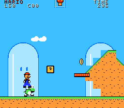
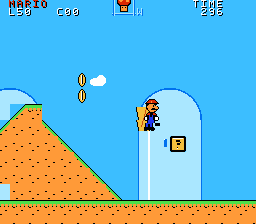

# Super Mario World → NES — Adventure 0.3

ROM **NES nativa**, programada en 6502 con ca65/ld65, para MMC3 NTSC. Este hito añade personajes redibujados, poderes, Yoshi, capa y una región navegable. Es una adaptación en desarrollo: **no es el port completo de SMW**.




## Jugar en Mesen

Abrí [`roms/smw-nes-adventure-v0.3.nes`](roms/smw-nes-adventure-v0.3.nes) como una ROM NES normal. Usá NTSC y mando 1. El mapa empieza en Yoshi's Island 1; movete a la izquierda para entrar en Yoshi's House, donde están los objetos de prueba. La casa se abandona caminando por el borde derecho.

| Control | Acción |
| --- | --- |
| Cruceta, en el mapa | Elegir uno de los cuatro nodos |
| A / Start, en el mapa | Entrar, si el camino está desbloqueado |
| Izquierda / derecha | Caminar; B para correr |
| A | Saltar; mantener para salto alto |
| B | Correr; disparar con Fire Mario; girar con capa; lengua sobre Yoshi |
| Arriba, cerca de Yoshi | Montar o recuperar a Yoshi |
| Select | Desmontar con salto; sin montar, soltar objeto de reserva |
| Start | Pausar; Select durante pausa vuelve al mapa |
| Capa: carrera sostenida y salto | Despegar; mantener A para vuelo/planeo; arriba eleva, abajo desciende |

La meta guarda caminos desbloqueados en SRAM de batería. Cerrá el emulador normalmente para que escriba su archivo de guardado. No necesitás un savestate. Para reiniciar el progreso, eliminá el guardado de batería de esta ROM desde el emulador. Checkpoints y Yoshi no se guardan entre sesiones.

Mesen y NES física todavía **no se han ejecutado** aquí. La verificación real disponible corresponde a FCEUX 2.6.5, PPU nueva, NTSC.

## Contenido implementado

- Mario pequeño, Super, Fire y Cape, animaciones de carrera/salto, transformación, daño y reserva visible en el HUD.
- Mushroom, Flower, Feather, Star, 1-Up, huevo de Yoshi y P-Balloon; bloques de interrogación y monedas.
- Bolas de fuego con rebote, giro de capa, despegue, vuelo controlable y planeo. El vuelo es una primera adaptación; no reproduce todavía toda la dinámica SNES.
- Yoshi con pose de montura, lengua, comer enemigos, desmontaje, huida al recibir daño y recuperación. Puede acompañarte entre regiones exteriores durante la sesión.
- Rex, Koopa y caparazones con arquitectura de ocho entidades; activación alrededor de la cámara e identidad persistente al retroceder.
- Plataformas móviles que transportan al personaje, pendientes básicas de 45°, checkpoint y finales de región.
- Mapa reducido con caminos, desbloqueos y guardado. HUD fijo mediante IRQ MMC3, cámara horizontal hasta 4,096 px y atributos NES reales.
- Gráficos redibujados para CHR 2bpp; melodía y efectos originales para la APU.

| Área | Alcance real |
| --- | --- |
| Yoshi's House | Una pantalla propia con casa, Yoshi y objetos accesibles |
| Yoshi's Island 1 | Reconstrucción parcial de la geometría de las primeras 16 de 20 pantallas de referencia, con sustituciones NES y meta añadida |
| Yoshi's Island 2 | Recorrido propio inspirado en plataformas de setas; no reconstrucción exacta del original |
| Iggy's Castle | Recorrido propio de piedra y lava; todavía sin jefe |

La colocación de enemigos/objetos y el fondo son adaptaciones propias. No están reconstruidas todas las interacciones de esos niveles. Las 96 salidas siguen pendientes.

## Compilar y verificar

```sh
sudo apt-get install cc65 make python3 fceux xvfb xauth ripgrep
export PATH="$PATH:/usr/games"
make check
make test
```

La compilación no necesita la ROM SNES, Internet ni módulos Python externos. Genera `build/smw-nes-adventure-v0.3.nes`, 73,744 bytes: mapper 4, 64 KiB PRG, 8 KiB CHR y 8 KiB WRAM con batería. GitHub Actions compila, compara el binario estable y ejecuta las pruebas.

`make test` ejecuta mecánicas con fixtures explícitos, reapertura real del guardado, recorrido por mando y comparación de físicas. Los resultados y límites están en [`docs/testing.md`](docs/testing.md), [`docs/test-results.txt`](docs/test-results.txt) y [`docs/motion-verification.md`](docs/motion-verification.md). Las físicas básicas conservan equivalencia en los 1,514 cuadros y 13,626 valores de referencia; esto **no certifica Yoshi, vuelo o pendientes** contra SNES.

## Pendiente y problemas conocidos

No hay jefe de castillo, salidas secretas, scroll vertical, agua/natación, puertas o tuberías transitables, menú de archivos ni Dinosaur Land completo. Faltan transportar objetos, interacción entre caparazones y enemigos y poderes de caparazones de colores de Yoshi. El P-Balloon usa elevación temporal sin una animación de inflado completa. Los objetos sueltos todavía no tienen toda su física SNES. La capa tiene un control simplificado; Yoshi escupe un proyectil genérico al consumir caparazón.

No existe un administrador general de los ocho sprites por línea: pueden aparecer recortes o parpadeo con Mario, Yoshi y varios actores alineados. Las paletas de sprites se comparten; un cambio de poder puede afectar colores de enemigos. Las transiciones reconstruyen pantalla con rendering apagado. La evaluación humana y auditiva sigue pendiente.

Próximo hito: completar Yoshi's Island 1 hasta su salida original, afinar pendientes y colocación de entidades contra la ROM, y comprobar vuelo/Yoshi en Mesen. Las ROM 0.1 y 0.2 siguen conservadas en `roms/` y Git.

## Referencia y procedencia

La ROM aportada se identificó como LoROM norteamericana, revisión interna 0, 512 KiB, sin cabecera de copiador, CRC32 `B19ED489`, checksum interno válido. Identificación completa: [`docs/reference-identification.json`](docs/reference-identification.json). El archivo comercial, los estados SNES y el desensamblado de referencia están excluidos del repositorio y las entregas.

El código 6502, dibujos de patrones y audio de esta compilación se producen en este proyecto; no se incluyen gráficos, música ni código extraídos de la ROM comercial. La geometría parcial se reconstruyó a partir de Map16 cargado, con conversiones a metatiles nativos: [`levels/README.md`](levels/README.md). Esto no concede derechos sobre personajes, marcas o diseño de niveles de Nintendo. No es un proyecto oficial.
